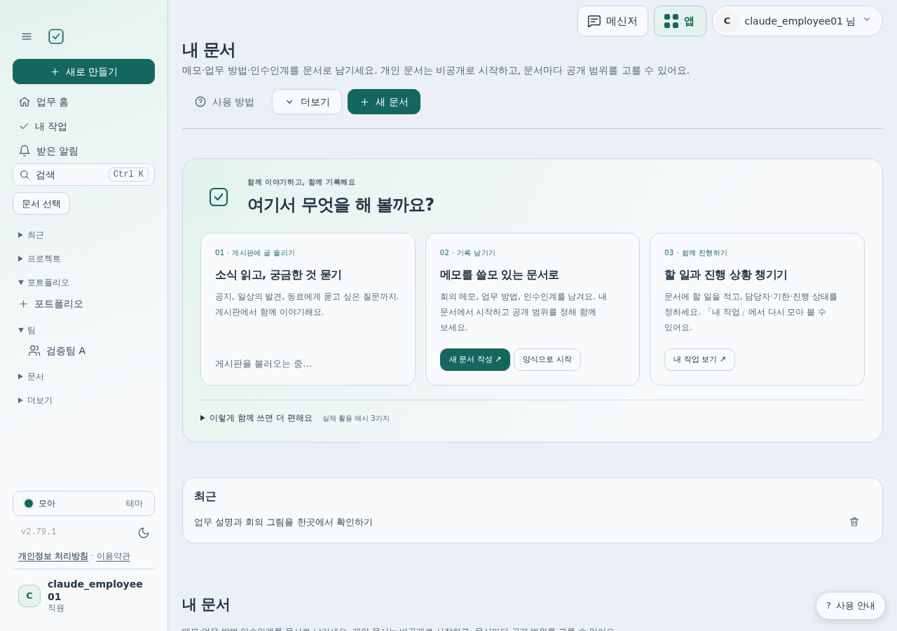
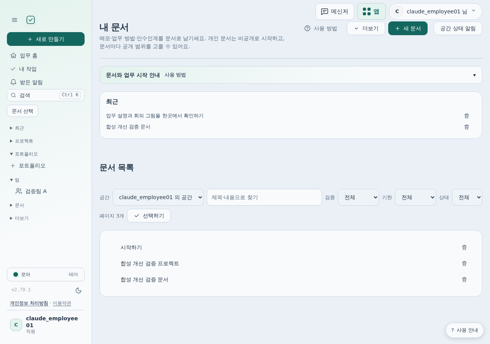
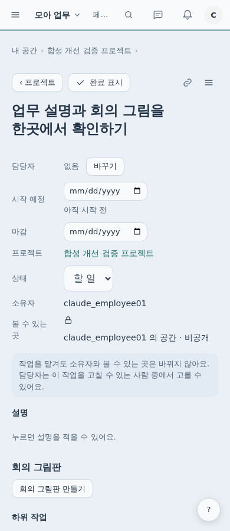
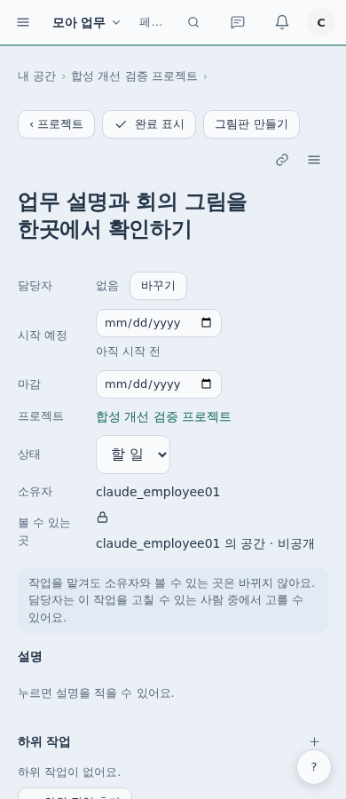
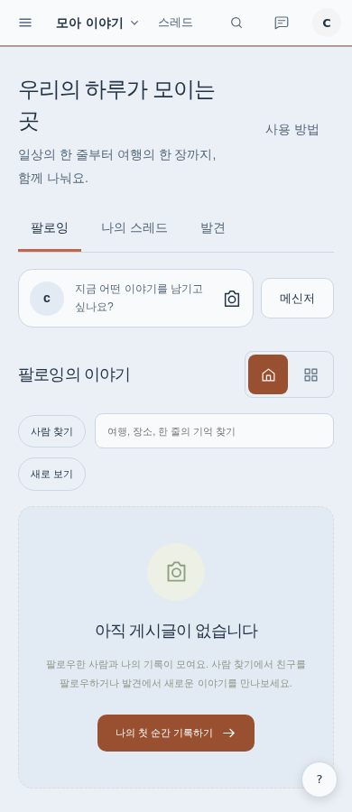
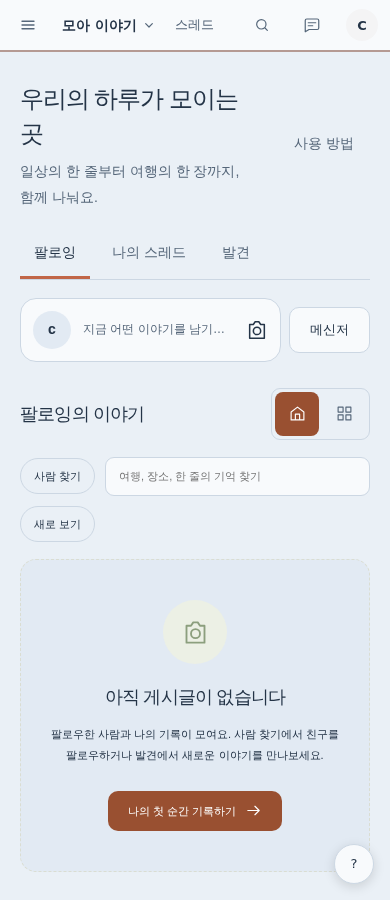
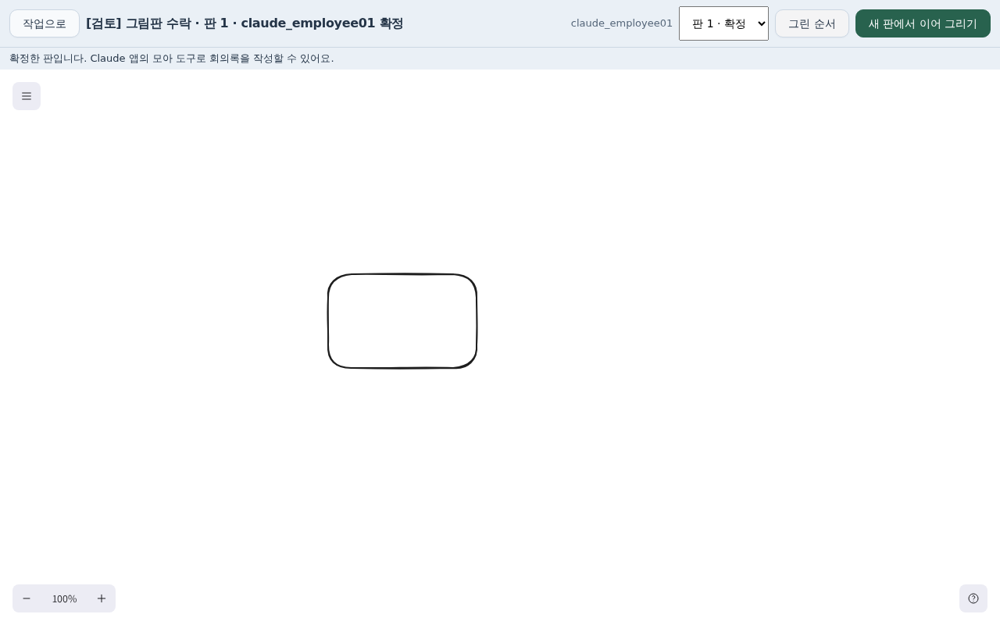
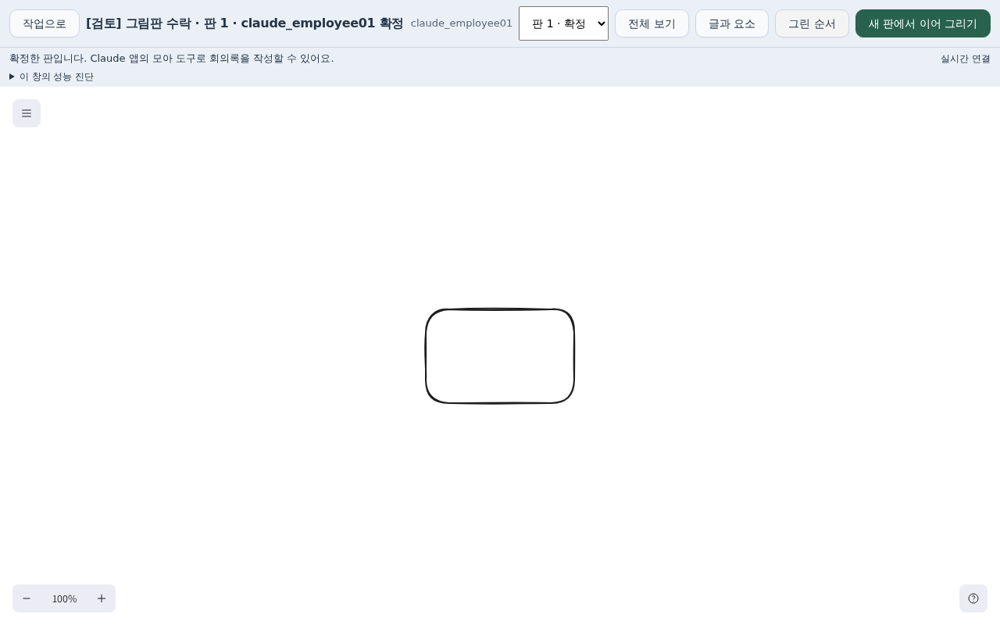

# MOA 전체 웹 개선 결과

v2.80.0의 초기 로딩·화면 안정성·편집·업로드·그림판 개선을 반영했습니다. 신규 [GitHub 저장소](https://github.com/Leechangkwon/MOA)에 기존 main 952커밋 이력을 보존했고, 검증한 발행 커밋은 `95322a1cb5686ea8e08594b864ec5ca36a839ccd`입니다.

Google 현대 웹 가이드252개 중 현재 적용 대상113개·조건부117개·비대상14개·초안8개를 분류했습니다. 이번 구현이 직접 닿는35개 핵심 가이드와 기존 기능 보존·추가 검증 조건은 [가이드별 대조표](guidance-252-implementation.csv)에 연결했습니다. 252개 전체 규칙의 준수 인증을 뜻하지 않습니다.

## 실제 HTTPS 전후 측정

6화면×PC/모바일×3회, cold cache·서비스워커 차단, PC1280×850 / 모바일390×844·RTT150ms·down1.6Mbps·up750Kbps·CPU4배 제한, 같은 서버에서 Chromium 실행. 전송량은 PC 중앙값, LCP는 PC와 모바일 각각의 중앙값입니다. 자동 로그인/로그아웃과 정상 조회의 부수 기록 외 실제 사용자 문서를 쓰지 않았습니다.

| 화면 | 초기 전송량 BE → AF | 변화 | PC LCP BE → AF | 모바일 LCP BE → AF |
| --- | --- | --- | --- | --- |
| 사이트 홈 | 318 → 271KiB | -14.8% | 0.376 → 0.448초 | 1.840 → 1.968초 |
| 업무 홈 | 807 → 493KiB | -39.0% | 0.892 → 0.780초 | 2.276 → 2.232초 |
| 내 작업 | 808 → 493KiB | -38.9% | 0.676 → 0.696초 | 2.176 → 2.156초 |
| 내 문서 | 823 → 508KiB | -38.2% | 0.876 → 0.768초 | 2.116 → 2.232초 |
| 이야기 | 396 → 350KiB | -11.7% | 0.776 → 0.640초 | 2.188 → 2.152초 |
| 자료실 | 351 → 356KiB | +1.5% | 0.804 → 0.568초 | 2.108 → 1.900초 |

LCP는 실험실3회 중앙값이며 현장 p75가 아닙니다. 작은 표본의 차이는 환경 변동도 포함합니다. 기존 gzip·정적 자산 캐시를 새 성과로 계산하지 않았습니다. 긴 작업과 Event Timing 최대값을 정식 INP로 바꾸어 부르지 않았습니다.

| 화면 | CLS 중앙값 BE → AF | AF 3회 중 최대 | ≤0.1 |
| --- | --- | --- | --- |
| 내 문서 PC | 0.4235 → 0.0559 | 0.0559 | 달성 |
| 내 문서 모바일 | 0.0218 → 0.0558 | 0.0558 | 달성 |
| 이야기 PC | 0.1397 → 0.0030 | 0.0030 | 달성 |
| 이야기 모바일 | 0.1681 → 0.0001 | 0.0001 | 달성 |

업무 홈의 초기 전송량500KiB 목표와 각 화면의 LCP는 별도로 판단합니다. 일부 화면의 LCP와 자료실 전송량은 증가했습니다. 위 표의 증가값도 그대로 포함했으며 모든 화면의 속도 목표를 달성한 것으로 판정하지 않았습니다.

CLS는 DCL뒤7초 관찰, 최근 입력 제외, 간격1초/길이5초 세션의 최대값입니다. 실제 사용자의 전체 방문 수명은 별도입니다. 자동 접근성 검사는 전체 접근성 인증이 아니며 물리 OS 글자 확대·Safari·스크린리더·실물 한글 IME는 추가 확인이 필요합니다.

## 화면에서 달라진 부분

문서·작업 입구·이야기는 같은 합성 자료와 같은 폭에서 기존 코드와 개선 코드를 실행한 화면입니다. 그림판 비교의 촬영 조건은 해당 절에 기재했습니다. 실제 사용자 문서·사진을 사용하지 않았습니다. AF 화면은 발행 전 후보 수락 때 촬영했으므로 화면 바닥의 버전은 이전 번호일 수 있습니다.

### 내 문서

큰 시작 안내와 반복 설명이 목록을 밀어냈고, 비동기 설명 변경이 단추를 다음 줄로 이동시켰습니다. 안내는 접어 두고 중복 제목·ID를 정리해 목록을 앞에 배치했습니다. 도움말과 만들기 동작은 펼치거나 기존 단추에서 계속 사용할 수 있습니다.

BE

AF

### 작업의 그림판 입구

설명 아래에서 찾아야 하던 그림판을 작업 머리에서 바로 열 수 있습니다. 서버가 허용한 작업에만 같은 입구를 보여 주며, 입구를 보는 것만으로 새 판을 만들지 않습니다.

BE

AF

### 이야기

작성 도구와 상태 줄의 공간을 먼저 확보해 목록 이동을 줄이고 작은 안내 글자의 대비를 높였습니다. 6개 디자인×밝게/어둡게×일반/고대비 집중 검사에서 대비 최소10.15:1을 확인했습니다.

BE

AF

### 그림판 조작과 상태

확대·축소와 마우스 조작에 의존하던 그림판에 전체 보기와 키보드로 고르는 요소 목록을 추가했습니다. 연결 상태와 서버 저장 상태도 나눠 연결됐다는 이유로 저장까지 끝났다고 오해하지 않게 했습니다. BE는11월18일 v2.79.1, AF는 이번 v2.80.0의 실제 HTTPS 합성 검토 문서입니다. 서로 다른 새 문서에서 같은1280×800·그리기/확정 절차를 촬영했으며 실제 사용자 문서는 아닙니다.

BE

AF

## 이미지보다 동작과 수치로 판단할 개선

- 초기 코드 분리: 업무를 읽을 때 편집기·ProseMirror·스키마·표 편집기를 받지 않고, 실제 편집을 시작하면 불러옵니다. 기다리는 동안 먼저 쓴 한글과 첨부·초점을 보존하고 기존 자동 저장으로 이어 줍니다. 자료실 코드도 해당 화면에서만 받습니다. 불필요한 전송·파싱·실행을 줄이는 것이 목적입니다.
- 업로드: 실제 바이트 진행과 서버 확인을 구분합니다. 전송100%를 검사 승인으로 표시하지 않고 목록의 검사 상태를 확인합니다. 결과를 모르는 네트워크 오류는 자동 재전송하지 않아 중복 업로드를 피합니다. 기존 동일 계정 CSRF 갱신만 한 번 재시도합니다.
- 입력과 오류: 한글 조합 중 Enter/229가 저장·전송을 실행하지 않게 하고, native 첫 오류 초점과 설명/ARIA를 연결합니다. reset은 자신의 오류만 정리하며 다른 설명을 보존합니다.
- 미디어와 긴 목록: 첫 이미지 우선, 뒤 이미지 lazy/영상 preload none, 화면 밖 독립 카드의 렌더 지연을 적용했습니다. 새 페이지는 기존 카드·초점·측정 크기를 보존하고 추가합니다. 없는 이미지 크기 메타데이터는 지어내지 않았습니다.
- 그림판: 최신 미리보기를 묶고 직렬화를 재사용하며 프레임마다 장면을 갱신합니다. 늦은 저장/폴링/판 전환 응답이 새 그림을 덮지 않도록 보호하고, 전체 보기·문자 요소 목록·연결/저장 상태·탭 내부 수치 진단을 추가했습니다.
- 진단: 명시적으로 켠 탭에서 계정·URL·본문·이벤트 ID 없는 숫자 집계만 메모리에 보관/다운로드합니다. 새 수집 서버·DB·영구 브라우저 저장을 추가하지 않았습니다.

## 그림판의 남은 성능 목표

6세션·실제 FPM8·같은2코어 호스트에서608.05초 동안282회 그리기, 미리보기3821개를 측정했습니다. p95는1195ms로 목표300ms에 **미달**했습니다. 이전1333ms보다 낮지만 이전330회/4810표본과 부하가 달라 순수 개선율로 해석하지 않습니다. HTTP p95는356.5→532.2ms로 증가했습니다. FPM최대활성7/8·대기열0, 중계기최대67.7MiB입니다. 이 값은 송신 시각→수신 뒤 두 animation frame의 동일 호스트 참고 실험이며 실제 paint·정식 INP·분산 기기 지연의 인증이 아닙니다. 분산 기기와 엔진 렌더 구간을 나눈 측정이 필요합니다.300ms 단언을 낮추거나 통과 처리하지 않았습니다.

## 검증과 원본 보존

실제 격리 PHP/DB/Chromium에서 공통69/0·편집/첨부/이미지/권한/모바일153/0·템플릿194/0·안내52/0·그림판 잔여 기능54/0. 공통 집중36/0·그림판 경합34/0·편집 지연14/0, 캐시 실패/복원 실제26/0, UI114/0·추가 검토63/0·안내126/0. 보안 린트0건·자산61/0·위키71편/0.300ms 부하는127통과/성능1실패로 별도 기록했습니다.

새 DB migration·운영 패키지·진단 서버는 없습니다. 암호화 백업2종의 checksum·전체 복호화·archive 구조를 확인하고, 기존 업무 행·소유권·ACL·원본 파일·설정 및 기존 모바일 수정/다른 작업 메모를 배포 전후 대조하여 변경/누락0을 확인했습니다. 운영 확인의 실제 결과는 [작업 기록](../../work-items/modern-web-improvements.md)과 [배포 기록](../../../deploy/production-state.json)에 있습니다. 다른 기능 회귀는 기존22시 밤 대기열에서 한 번 진행합니다.

## 적용 범위와 남은 검증

초기 코드 분리·화면 배치·첫 입력/첨부·업로드 상태·그림판 조작은 이번 판에 반영했습니다. 사진20/100/500장 및 원본 크기별 전송/메모리/스크롤 성능, 실제 현장 p75, 물리 기기·OS 글자 확대·Safari·스크린리더, 분산 기기의300ms 지연 분해는 추가 검증 항목입니다. 미디어 우선순위·목록 DOM 보존 검사를 대규모 사진 피드 성능 결과로 바꾸어 부르지 않습니다.

서버 DB 실행계획·악성코드 검사 대기시간·PC 비서와 MCP 호출 성능은 별도 계측 영역으로 남겼습니다. 이번 웹 가이드 적용과 정상 기능 보존을 이 영역의 성능 개선 완료로 확대하지 않습니다. 현재 숫자 진단은 사용자가 켠 탭의 메모리 집계이며 실제 방문자 정보를 모으는 새 수집 서비스를 배포하지 않았습니다.
